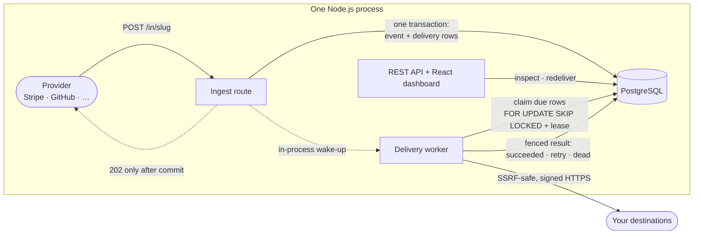
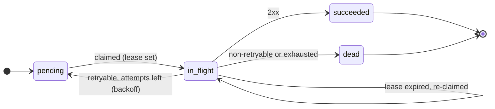

<p align="center">
  <a href="https://relayforge-r0l7.onrender.com"></a>
</p>

<p align="center">
  <a href="https://github.com/nick10-05/RelayForge/actions/workflows/ci.yml"></a>
  
  
  
  
  
  
</p>

<p align="center">
  <b><a href="https://relayforge-r0l7.onrender.com">Live demo</a></b> ·
  <a href="https://relayforge-r0l7.onrender.com/api/v1/docs">API docs</a> ·
  <a href="docs/design.md">Design doc</a> ·
  <a href="docs/adr/README.md">Decision records</a> ·
  <a href="docs/deploy.md">Deploy guide</a>
</p>

## ⚡ At a glance

| 🛡️ Never loses an event | 🔁 Retries done right | 🔐 Secure by default | 🧪 Proven, not claimed |
|---|---|---|---|
| Acknowledges only after the event is committed; a transactional outbox writes the event and its deliveries together | `SKIP LOCKED` claiming, leases, fenced completion, full-jitter backoff and a dead-letter state | SSRF-safe outbound client, Standard Webhooks signing, AES-256-GCM secrets, argon2id, tenant isolation | 555 tests on real Postgres, a chaos receiver, 665 req/s peak ingest in a local k6 run, and all 38,260 events delivered in a crash test where the server was killed mid-run |

## 🎯 The problem

Webhooks from Stripe, GitHub, Razorpay or Shopify are fire-and-forget HTTP calls. If your server is mid-deploy, or a bug returns `500`, the provider retries a few times, gives up, and you are left with no record of what was sent.

**RelayForge sits between the provider and your app.** It:

1. **Receives** every webhook on a stable URL and acknowledges it only after it is safely in the database.
2. **Stores** the raw request byte for byte, so the provider's own signature still verifies at your end.
3. **Forwards** it to one or more destinations with retries, exponential backoff, crash recovery and a dead-letter state.
4. Lets you **inspect and redeliver** any event from a dashboard or the API.

## 🧩 How it works



**Postgres is the queue.** The `deliveries` table *is* the job queue. Writing the event and enqueueing its deliveries happen in the same transaction (a transactional outbox), so an event can never be stored without its deliveries, or the other way round. No Redis, no RabbitMQ, nothing extra to run or pay for.

### Every delivery follows one state machine



| Outcome | What happens |
|---|---|
| `2xx` | succeeded |
| `408`, `429`, `5xx`, timeout, DNS / connect / TLS / reset errors | retried, with `Retry-After` honoured |
| `3xx` | dead (`redirect`). Redirects are never followed |
| any other `4xx` | dead (`non_retryable_status`) |
| blocked by the SSRF guard | dead (`ssrf_blocked`) |

Backoff is `random(0, min(1 h, 30 s × 2^(attempt−1)))` with **full jitter**, and 10 attempts by default (about 3 hours worst case), configurable per destination.

## 🛡️ What makes it reliable

- **Acknowledge only after commit.** A crash before the commit makes the provider retry; a crash after it leaves the delivery rows in place for the worker.
- **`SKIP LOCKED` claiming.** Concurrent workers take disjoint rows without blocking each other.
- **The lease is `next_attempt_at`.** If a worker dies mid-request, its row simply becomes due again. No sweeper job is needed.
- **Fenced completion.** A result is written only if the worker still holds the lease *and* the attempt number matches, so a slow, stale worker cannot overwrite a newer result.
- **Poison-payload protection.** Attempts are counted when a row is claimed, so a payload that crashes the worker still runs out of attempts and ends `dead` instead of looping forever.
- **No lock is held during the HTTP call**, and `SIGTERM` drains in-flight work before exiting.
- **The worker sleeps** until the next due row or an in-process signal, so the free database can scale to zero.
- **Pause means hold, never drop.** A paused endpoint keeps storing events and delivers them on resume.

### Guarantees, stated plainly

**At-least-once delivery.** Exactly-once is impossible over HTTP, so every attempt, retry, fan-out and replay carries the same `X-RelayForge-Id`. De-duplicate on it. Events can arrive **out of order**, which is the same contract Stripe and GitHub give.

| Outbound header | Purpose |
|---|---|
| `X-RelayForge-Id` | Event id, identical across retries and replays: your dedupe key |
| `X-RelayForge-Delivery-Id` / `X-RelayForge-Attempt` | Debugging and observability |
| `X-RelayForge-Replay` | `true` on manual redeliveries |
| `X-RelayForge-Timestamp` / `X-RelayForge-Signature` | Authenticity (Standard Webhooks algorithm) |

## 🔐 Security

- **SSRF-safe outbound client** built on `node:https` with a pinned DNS lookup. Every resolved address is checked against a blocklist of private, loopback, link-local and other internal IPv4 and IPv6 ranges. URLs are checked at creation *and* at send time to stop DNS rebinding. No redirects, and size and time caps on every request.
- **Outbound signing** with the Standard Webhooks algorithm (HMAC-SHA256) and zero-downtime secret rotation.
- **Inbound verification** (generic HMAC or Standard Webhooks) using constant-time comparison. Forged requests get `401`, are stored briefly for debugging (64 KB, 24 h, their own stricter rate limit), and are **never forwarded or replayable**.
- **Inbound de-duplication** on a header or JSON field. A duplicate gets `200` with the original event id and is counted, not re-sent.
- **Accounts:** argon2id passwords, hashed session tokens in `__Host-` cookies, CSRF origin checks, login rate limits, and scoped API keys.
- **Secrets at rest:** AES-256-GCM with per-row authenticated data and a rotatable keyring. Secrets are redacted from logs, and a test checks it.
- **Tenant isolation:** every query is scoped to its owner, and cross-tenant access returns `404`.
- **Abuse limits:** 1 MB body cap, per-endpoint token-bucket rate limits, a storage guard that returns `503` before the free database fills up, and automatic retention cleanup.

## 🧪 Tested like it matters

**46 test files (555 tests)** run in CI, and the integration tests use a **real PostgreSQL 18**, not mocks. Server line coverage is **about 95%** (`npm run test:coverage`); what's left is mostly entry points and the real-DNS resolver. They include:

- **Engine invariants** ([`invariants.test.ts`](apps/server/src/delivery/invariants.test.ts)): N concurrent workers send each delivery exactly once; a worker that dies mid-request is recovered after its lease expires; a stale worker cannot overwrite a newer result; a crash-inducing payload ends `dead`; a forged event never causes an outbound request.
- **Reliability under load** ([`reliability.test.ts`](apps/server/src/delivery/reliability.test.ts)): 4 schedulers × 8 slots, and 12 tight-batch workers racing the claim and the reaper, with no double sends and nothing stuck. Also covers a crash between send and completion.
- **End-to-end flows** ([`flows.test.ts`](apps/server/src/e2e/flows.test.ts)) over real HTTP: ingest → fail → retry → succeed (signed, same id), dead → fix → manual retry (double-click safe), forged requests, duplicates, pause/resume, API keys, rate limits, body cap and CSRF.
- A **chaos receiver** that returns `500`s, `429` with `Retry-After`, hangs, connection resets, redirects, and "200 after N failures".

Every push runs format check → lint → type-check → tests → dashboard build → Docker image build.

### 📈 Load numbers (measured locally)

One Node process (API + worker, delivery concurrency 8) and Postgres 18 in Docker on a Windows laptop, k6 at a **constant arrival rate** ([`load/ingest.js`](load/ingest.js)), destination = the local chaos receiver. Measured 16 Nov 2026 unless marked.

| Scenario | Result |
|---|---|
| Ingest only, 200 req/s × 30 s | 6,000/6,000 accepted (`202`), 0 errors · latency p50 6.9 ms, p95 10.2 ms, p99 21.9 ms |
| Ingest + 1 destination, 200 req/s × 30 s | ingest p95 19 ms · **6,001/6,001 delivered, all on the first attempt** · received → delivered p50 29 ms, p95 46 ms, max 91 ms |
| Ingest + 1 destination, 500 req/s × 30 s | 14,946 accepted, 0 errors, ingest p95 118 ms · the worker drains ≈ 210–260/s, so a backlog builds and clears ~40 s after the run · all 14,946 delivered on the first attempt |
| Server killed mid-run (14 Nov) | 38,260/38,260 delivered · 5 retried after their lease expired · 1 duplicate request at the receiver (at-least-once), 0 duplicate delivery rows |

**Where it tops out:** ingest ≈ 665 req/s; delivery is the bottleneck, because every attempt opens a fresh TCP/TLS connection (deliberate: the socket must connect to the address the SSRF guard just vetted) and records its result in a transaction. Raising worker concurrency to 32 gave ≈ 440/s (14 Nov).

**Why not on the live site:** Render Free has 0.1 CPU and the per-endpoint ingest limit is 20 req/s by design, so a load test there would measure the free tier and the rate limiter, not the engine.

## ⚖️ Engineering decisions & trade-offs

Each one has a short decision record in [`docs/adr/`](docs/adr/README.md).

| Decision | Why | What it costs |
|---|---|---|
| **Postgres is the queue** ([ADR 0001](docs/adr/0001-postgres-as-the-queue.md)) | Storing the event and queuing its deliveries happen in one transaction, so neither can exist without the other; no broker to run or pay for | Lower peak throughput than a dedicated broker; fine at this scale |
| **The lease is `next_attempt_at`** ([ADR 0002](docs/adr/0002-lease-stored-as-next-attempt-at.md)) | A crashed worker's row simply becomes due again, with no sweeper job and no lock or open transaction held during the HTTP call | A worker that is slow, not dead, can be overtaken, so completion is fenced on the attempt number |
| **Forged requests are stored, never forwarded** ([ADR 0003](docs/adr/0003-invalid-signature-policy.md)) | Developers can see why verification failed, and forged traffic still can't reach a destination | Capped storage (64 KB, 24 h) and a stricter rate limit for those requests |
| **No ordering guarantee** ([ADR 0005](docs/adr/0005-no-ordering-guarantee.md)) | Ordering would let one failing event block every later one for hours, and rule out concurrency, fan-out and replay | Receivers de-duplicate on `X-RelayForge-Id` and must not assume order, the same contract Stripe and GitHub give |
| **Node 24 runs TypeScript by type stripping** ([ADR 0004](docs/adr/0004-node-24-with-type-stripping.md)) | No build step for the server: the code you read is the code that runs | Syntax that needs code generation (`enum` and similar) is off-limits |
| **A fresh connection for every delivery** | The socket must connect to the exact address the SSRF guard just vetted | Delivery tops out around 210–440/s locally; connection reuse is the known next step |

## 🧰 Tech stack

| Layer | Choice |
|---|---|
| Runtime | Node.js 24 LTS, running TypeScript directly with built-in type stripping (no build step for the server) |
| HTTP | Fastify 5, Zod schemas, `@fastify/helmet` |
| Data | PostgreSQL 18, Drizzle ORM and migrations, raw SQL for claiming |
| Outbound HTTP | `node:https` with a custom `lookup` (no HTTP client library) |
| Crypto | `node:crypto`, `@node-rs/argon2` |
| Dashboard | React 19, Vite 8, TanStack Query, Tailwind CSS 4; hand-written SVG charts and canvas globe (no chart or map library) |
| Quality | Vitest, ESLint, Prettier, GitHub Actions, k6 load script |
| Hosting | One Docker image on Render Free + Neon Postgres: **₹0 a month, no card** |

## 💻 Run it locally

<details>
<summary><b>Setup, demo script, chaos receiver and load test</b></summary>

You need **Node.js 24.16+** and **Docker**.

```bash
git clone https://github.com/nick10-05/RelayForge.git
cd RelayForge
npm ci
cp .env.example .env            # PowerShell: Copy-Item .env.example .env

# Generate an encryption key and paste it into ENCRYPTION_KEYS in .env
node -e "console.log('k1:' + require('crypto').randomBytes(32).toString('base64'))"

npm run db:up                   # Postgres 18 in Docker (localhost:5433)
npm run db:migrate
npm run dev                     # API + delivery worker on http://localhost:3000
npm run dev:web                 # dashboard (Vite dev server), in a second terminal
```

Before every commit: `npm run check` (format, lint, type-check, all tests).

**API docs:** interactive OpenAPI 3.1 docs at [`/api/v1/docs`](https://relayforge-r0l7.onrender.com/api/v1/docs) (spec at `/api/v1/docs/json`), generated from the same Zod schemas the server validates with.

**The engine in 5 seconds:** with `ALLOW_PRIVATE_DESTINATIONS=true` in `.env` and `npm run dev` running, `npm run demo` drives the real server over HTTP against its own chaos receiver. It shows one event fanned out to five receivers (success, 429 + `Retry-After` then success, 404, redirect, retries exhausted), signatures verified at the receiver, inbound dedupe, a double-clicked retry (`202` + `409`) and a forged request that is stored but never forwarded. It prints a dashboard link to the same event.

```text
  healthy receiver                             200                succeeded
  rate-limited twice (429 + Retry-After: 1)    429 → 429 → 200    succeeded
  wrong URL (404)                              404                dead (non_retryable_status)
  redirects (302)                              302                dead (redirect)
  always 429, max 3 attempts                   429 → 429 → 429    dead (exhausted)
```

**A destination that misbehaves on purpose:** `node apps/server/src/testing/chaos-cli.ts 4100` starts the chaos receiver locally. Set `ALLOW_PRIVATE_DESTINATIONS=true` in `.env` to point a destination at it (this is refused in production).

**Load test:** `k6 run load/ingest.js` (see the comments in the file for rate, duration and fan-out options).

</details>

## 🚀 Deploy

**Live:** [relayforge-r0l7.onrender.com](https://relayforge-r0l7.onrender.com) (Render Free in Singapore: after 15 idle minutes the first request takes about a minute while the service wakes up).

One Docker image runs the API, the worker and the dashboard, and applies migrations on start. [`docs/deploy.md`](docs/deploy.md) walks through Render Free + Neon step by step, including what the free tier means for delivery timing.

## 📐 Design

The full design, with every decision and trade-off, is in [`docs/design.md`](docs/design.md): the delivery engine, idempotency, data model, security, operations, and a decisions log. The five choices that shape the engine have short decision records in [`docs/adr/`](docs/adr/README.md): Postgres as the queue, the lease as `next_attempt_at`, the invalid-signature policy, Node 24 with type stripping, and no ordering guarantee.

**Out of scope, on purpose:** teams and roles, billing, multi-region, ordering guarantees, and exactly-once delivery.

## 🗂️ Project layout

<details>
<summary><b>Where everything lives</b></summary>

```
apps/
  server/src/
    ingest/        receive, verify signatures, de-duplicate, store (outbox)
    delivery/      claim, send (SSRF-safe), classify, schedule, sign, complete, redeliver
    auth/          passwords, sessions, API keys, route guards
    http/          CSRF, limits, hardening, log redaction, OpenAPI docs, SPA serving
    ops/           retention job, storage guard
    stats/         GET /api/v1/stats: counts, backlog, 24 h delivery health, hourly series
    testing/       chaos receiver, fake DNS, test helpers
  web/src/         React dashboard: landing page with a canvas globe, live overview (charts,
                   activity feed, relay topology), endpoints, events, attempt trace, redeliver
docs/              design.md, deploy.md, adr/ (decision records)
load/              k6 ingest load test
```

</details>
